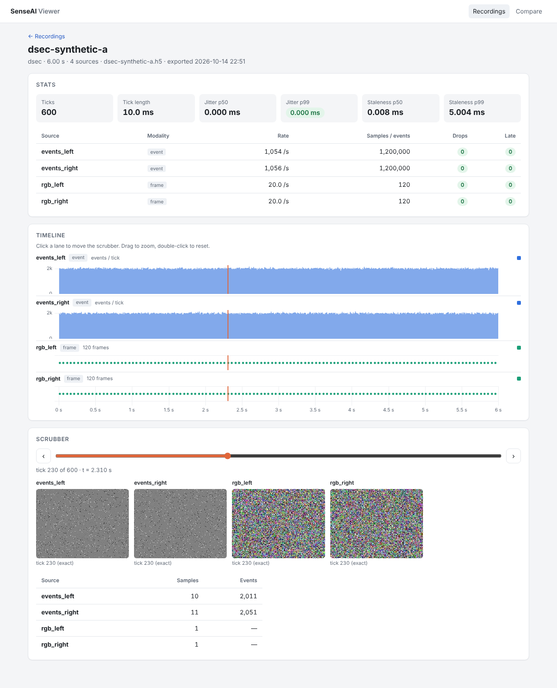

# senseai-viewer

Browse [`senseai-ingest`](https://github.com/senseai-institute/ingest) recordings in a web browser.
You don't need Python, HDF5 or a work computer to use it.


<sub>The recording view on a synthetic DSEC recording. `make demo` regenerates this screenshot.</sub>

`senseai-ingest replay` writes **tick files**: HDF5 files, from tens to hundreds of MB, that
record what every sensor produced in each 10 ms tick. The viewer turns them into something you
can look at, in two parts:

1. **`senseai-viewer export`** runs where the tick files are, such as your work computer or a CI
   job. It reads one tick file and writes a small **summary** of a few MB. The summary holds a
   manifest, per-tick counts, downsampled traces and a few thumbnails, and the exporter can upload
   it to S3.
2. **The web app** runs on Railway. It reads the summaries from S3 and shows:
   - a list of recordings;
   - for each recording, a stats card (sync jitter, drops, rates), a timeline with one lane per
     sensor, and a scrubber that shows the camera frame and event image for any tick.

The web app never opens a tick file. It contains no model code and never touches raw datasets.

```
 work computer                                   S3                              Railway
 ┌──────────────┐ senseai-viewer export ┌────────────────────────┐  boto3  ┌──────────────────────┐
 │ ticks.h5     │──────────────────────▶│ viewer/<id>/manifest…  │────────▶│ FastAPI + static SPA │──▶ browser
 │ (TickReader) │      --upload         │  timeline, traces, jpg │ (cached)│  HTTP Basic auth     │
 └──────────────┘                       └────────────────────────┘         └──────────────────────┘
```

## What you see

- **Recordings**: each recording's name, dataset, duration, number of sources, sync jitter p99,
  drops and export date.
  - Jitter p99 is green below 1 ms.
  - Drops are green at 0.
  - The page works on a phone.
- **Recording**: the page has three parts.
  - **Stats card.** Ticks, tick length, jitter p50/p99, staleness, and per-source rate, drops
    and late samples.
  - **Stacked timeline.** One lane per source:
    - event sources: events per tick, as bars;
    - frame sources: a dot per frame;
    - audio sources: RMS per channel;
    - IMU sources: accelerometer and gyro lines.
  - **Scrubber.** It shows the nearest frame and event thumbnails, and the exact sample count of
    every source, for the selected tick. Clicking anywhere on the timeline moves it.
- **Compare**: overlays the events-per-tick traces of two recordings.

If a summary lacks a piece, such as thumbnails, that panel says "not available" instead of
breaking.

## Export a recording

```bash
pip install "senseai-viewer @ git+https://github.com/senseai-institute/viewer.git"

# 1. Make a tick file with senseai-ingest, if you don't have one yet
senseai-ingest replay --dataset dsec --path /data/dsec/zurich_city_04_a --out zurich_city_04_a.h5 --stats

# 2. Export a summary to ./out/zurich_city_04_a/
senseai-viewer export zurich_city_04_a.h5

# 3. Export and upload to s3://$S3_BUCKET/$S3_PREFIX/<id>/ (S3_PREFIX defaults to "viewer")
S3_BUCKET=my-bucket AWS_REGION=eu-central-1 senseai-viewer export zurich_city_04_a.h5 --id zurich-04a --upload
```

- `--id` sets the recording id. By default the exporter derives it from the file name.
- `--out DIR` changes the local output root, which defaults to `./out`.
- Exports are deterministic: the same tick file always gives the same summary.
- Exporting a 1,000-tick, 4-source DSEC file (2 × 200k events/s plus 2 cameras) takes about
  17 s. Nearly all of that time is spent reading the tick file through `TickReader`.
- The upload uses the standard AWS credential chain, such as environment variables or
  `~/.aws`. It writes `manifest.json` last, so the viewer never shows half-uploaded recordings.

The summary contract (files, columns and units) is in
[`docs/summary-format.md`](docs/summary-format.md). The contract is versioned. After an upgrade
that changes the version, re-export.

## Deploy on Railway

1. **Connect the repo.** In Railway, choose *New Project → Deploy from GitHub repo* and pick this
   repository. Railway builds the `Dockerfile`. `railway.json` sets the health check to
   `/healthz`.
2. **Set the variables.** In the service's *Variables* tab, set:

   | Variable | Required | Meaning |
   |---|---|---|
   | `S3_BUCKET` | yes | The bucket that holds the summaries. |
   | `AWS_REGION` | yes | The bucket's region, such as `eu-central-1`. |
   | `AWS_ACCESS_KEY_ID` | yes | Key ID of an IAM user with `s3:ListBucket` on the bucket and `s3:GetObject` on `<prefix>/*`. The user needs read access only. |
   | `AWS_SECRET_ACCESS_KEY` | yes | The secret for that key. |
   | `VIEWER_PASSWORD` | yes | The shared password. The browser asks for it, and the username can be anything. |
   | `S3_PREFIX` | no | The key prefix of the summaries. Defaults to `viewer`. |
   | `CACHE_TTL_S` | no | How long, in seconds, the server keeps listings and summaries in memory. Defaults to `60`. |

   Railway sets `PORT` and `RAILWAY_ENVIRONMENT` itself. If `VIEWER_PASSWORD` is missing while
   `RAILWAY_ENVIRONMENT` is set, the server refuses to start.
3. **Generate a domain.** Under *Settings → Networking → Generate Domain*, create a domain, open
   it, and enter the password.

To show a new recording, run `senseai-viewer export … --upload`. It appears within `CACHE_TTL_S`
seconds, with no redeploy.

Everything except `/healthz` is behind HTTP Basic auth. Railway serves the app over HTTPS, so the
password is not sent in clear text.

## Run locally

You don't need S3 to run the viewer locally. Point it at a folder of summaries instead:

```bash
make demo          # synthetic DSEC fixtures → senseai-ingest replay → export → serve at http://127.0.0.1:8000
```

Or run the steps yourself:

```bash
uv sync --extra dev
(cd frontend && npm ci && npm run build)
senseai-viewer export ticks.h5                     # writes ./out/<id>/
uv run senseai-viewer serve --summaries ./out --port 8000
# equivalent: LOCAL_SUMMARIES=./out uv run uvicorn senseai_viewer.api.app:create_app --factory --port 8000
```

- When `LOCAL_SUMMARIES` is set, the server reads that folder and never contacts S3.
- `make demo` also writes `docs/screenshot.png`. `DEMO_PORT` changes its port.
- When `VIEWER_PASSWORD` is unset, it runs without a password. That is allowed only outside
  Railway.
- For frontend work, run `npm run dev` in `frontend/`. It proxies `/api` to `localhost:8000`.

## API

All endpoints return JSON except the thumbnails. In the endpoints below, `{id}` is the recording
id and `{sid}` is the source id.

| Endpoint | Returns |
|---|---|
| `GET /healthz` | `{"status": "ok"}`. This endpoint is not password-protected. |
| `GET /api/recordings` | A summary row for each `<prefix>/*/manifest.json`. |
| `GET /api/recordings/{id}` | The manifest. |
| `GET /api/recordings/{id}/timeline` | `timeline.parquet` as columnar JSON: `{"n_rows", "columns": {name: [...]}, "meta"}`. Absolute ns timestamps are decimal strings. |
| `GET /api/recordings/{id}/traces/{sid}` | `traces/{sid}.parquet` as columnar JSON. |
| `GET /api/recordings/{id}/thumbs/index.json` | The thumbnail index. |
| `GET /api/recordings/{id}/thumbs/{sid}/{k}.jpg` | One thumbnail, streamed from S3 and cached. |

A missing piece returns `404`, and the UI renders "not available".

## Development

Requirements: Python ≥ 3.11 with [`uv`](https://docs.astral.sh/uv/), and Node ≥ 20.

```bash
make test      # pytest with coverage (≥ 80 %), including the Playwright smoke test
make lint      # ruff check + ruff format --check
make type      # mypy --strict on src/
make build     # builds the frontend into src/senseai_viewer/static/
make demo      # end-to-end: fixture → replay → export → serve → screenshot to docs/screenshot.png
```

- The tests generate their tick files with `senseai_ingest.testing.make_dsec_fixture` and
  `senseai-ingest replay`, so CI needs no datasets or AWS.
- The S3 path is tested once with `moto`.
- GitHub Actions (`.github/workflows/ci.yml`) runs `make lint type build test` on every push. It
  also builds the Docker image and checks that the image refuses to start without a password,
  and that it passes the health check with the five Railway variables.
- The Playwright test needs Chromium. Install it with `uv run playwright install chromium`.

```
src/senseai_viewer/
  export/      tick file → summary (TickReader only); writes manifest, timeline, traces, thumbs
  api/         FastAPI app, storage backends (S3 / local folder), TTL cache, Basic auth
  static/      built frontend (generated, not committed)
frontend/      Vite + TypeScript SPA, uPlot charts
tests/         pytest (export, API, moto) + Playwright smoke test
scripts/       demo.py (make demo)
docs/          summary-format.md, screenshot.png
```

## License

Apache-2.0. Copyright 2026 SenseAI Institute. See [`LICENSE`](LICENSE).
